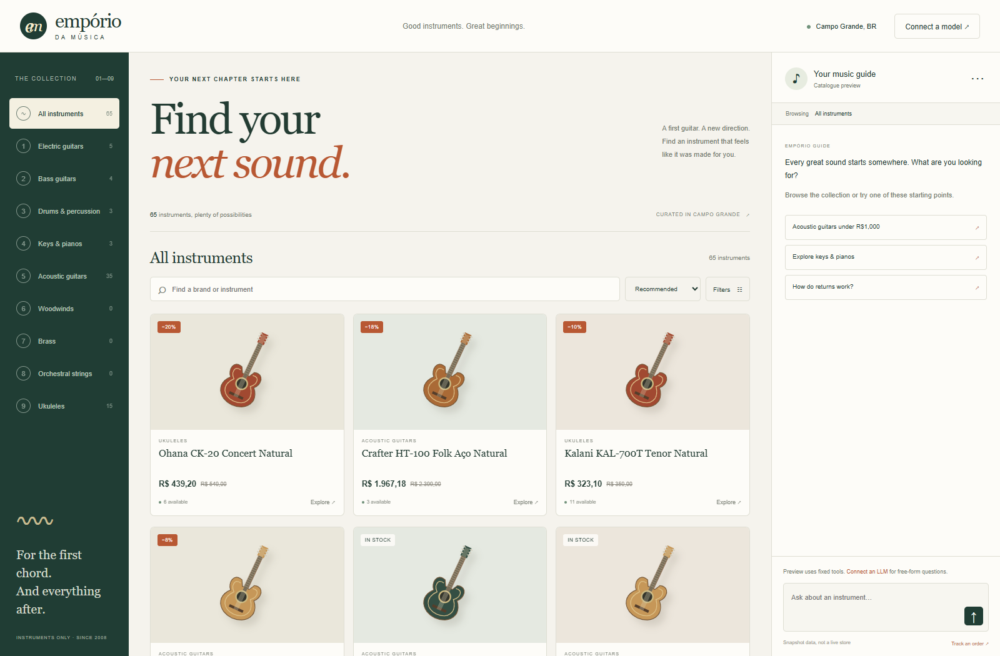
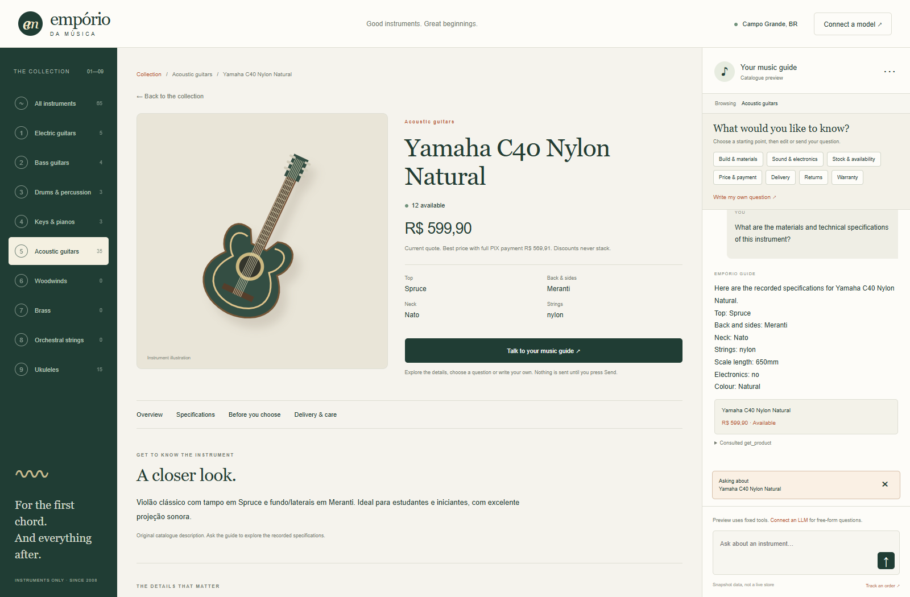

# Empório da Música

A local instrument catalogue with a store assistant, built for Artefact's AI Engineer challenge. The prototype combines a clickable collection, a side chat, SQLite-backed tools and an OpenAI-compatible model connection. It runs on your computer without rented hosting.



The catalogue, filters, product details, discount calculations, policy lookup, order demonstration check and Markdown conversation export work without an API key. In that mode the interface clearly says Catalogue preview. It uses a small deterministic router and is not an LLM. To interpret free-form messages, connect a tool-capable model in the settings dialog.

The application was checked with Python 3.12 under Ubuntu WSL and Python 3.13 under Windows. Run the following commands from the repository root in Ubuntu or the VS Code WSL terminal.

```bash
python3 -m venv .venv
.venv/bin/python -m pip install -r requirements.txt
.venv/bin/python run.py
```

Open `http://localhost:8765` in your browser. Stop the server with Ctrl+C. If the environment is already installed, only the last command is needed. On this workstation, `start-wsl.cmd` also launches the prepared Ubuntu environment from Windows.

For a separate Windows environment, use the following PowerShell commands. Keep the Windows and WSL environments separate.

```powershell
python -m venv .venv-win
.\.venv-win\Scripts\python.exe -m pip install -r requirements.txt
.\.venv-win\Scripts\python.exe run.py
```

The included `start-windows.cmd` launches an existing Windows environment. Both launchers use the same project files. The generated SQLite databases live in the ignored `.runtime` directory and are rebuilt from the original CSV files at startup. Run one web instance at a time.

Choose Connect a model and enter the API base URL, model ID and key if required. The endpoint must support Chat Completions with function tools. Presets cover common local addresses and OpenAI, but they do not guarantee compatibility. Load models queries the configured endpoint, and manual model entry remains available. A successful model list does not verify tool calling. Qwen3.6-35B-A3B is the reference candidate. A local abliterated Q8_0 variant has passed a two-turn smoke test with a greeting and a selected-product PIX query. A targeted Bonsai27B policy review has since passed twelve live cases in English and Brazilian Portuguese, including changes during one conversation. Two answers required the application to supply a missing policy lookup. The [recorded conversation](examples/04-bonsai-policy-review.md) distinguishes model behaviour from application safeguards. Broader model evaluation remains open.

The EN and BR buttons next to the store location select English or Brazilian Portuguese for the interface and future assistant replies. The active button has a pressed appearance. The browser remembers the preference, and each chat request sends it again. The backend places the current language in the single first system message for every model round, overriding earlier history and any language request in customer text. Changing language keeps the conversation and model connection. Existing replies retain their original language, while new replies follow the selection. The switch is temporarily disabled during a reply, and sending is paused while a language change completes.

Catalogue descriptions, policy summaries, product response templates and interface labels have both language paths. Codex prepared English translations of the 65 supplied descriptions, while the original Portuguese CSV files and manual remain unchanged. Product names, identifiers, source references and technical schemas retain their original form. Translation does not resolve conflicting catalogue facts. The language browser check is `scripts/check_language.py` and covers switching during a conversation, replies to questions in the other language, older product cards, reload persistence and the mobile layout.

The endpoint address is resolved from Python, not from your browser. A Windows-hosted model service may require a Windows host address when the application runs in WSL. API keys are kept only in the current server-side browser session, never returned to the interface or written to disk. Changing the endpoint without supplying a new key clears the old key. Restarting the server or two hours of inactivity discards the session.

FastAPI serves the HTML, CSS and JavaScript interface without a frontend build step. SQLite handles structured catalogue and order queries. Python validates tool parameters and calculates prices in integer cents with decimal rounding. The model chooses tools, while product cards and factual responses are rendered from tool results. An unsupported final answer without evidence falls back to a clarification instead of displaying unverified model claims. This conservative first version trades flexible phrasing for predictable facts.

The browser and agent share `search_products`, `get_product`, `lookup_policy`, `get_order` and `navigate_catalog`. The chat menu exposes their descriptions and input schemas. The current category, selection, filters and visible product IDs accompany each message. Explicit references take precedence over navigation context. The agent can propose catalogue navigation without pixel-based browser automation. The customer chooses the separately rendered Open button before the view changes.

The official MCP Python SDK provides a thin stdio adapter for the three public read tools. Run it from the prepared environment with the following command.

```bash
.venv/bin/python run_mcp.py
```

This command waits for an MCP client on standard input and output, so it does not open a webpage. Configure your MCP host with absolute paths to the environment's Python executable and `run_mcp.py`. The adapter deliberately excludes private orders and browser navigation because it does not share the browser's verified session. It uses the same tool implementations as the web app and never prints ordinary application output into the protocol stream.

The policy tool retrieves complete relevant pages from the supplied PDF and returns their source references with reviewed English summaries. Chat source links open the original manual. This is a small page-level retrieval approach without embeddings or a vector database. It is intentionally limited to named policy topics rather than a general document search engine. Specific questions now select reviewed details for instalments, mixed payments, refunds, return conditions, warranty exclusions and shipping rather than displaying every fact in the topic. The original customer question controls that selection even if a model paraphrases it or requests an unrelated topic. Supported detail questions trigger a logged manual lookup if the model omits it. Pure policy replies suppress unsolicited product facts and cards. Unknown wording still falls back to a topic summary, so this is bounded detail selection rather than unrestricted semantic retrieval.

Discounts never stack. The system chooses the highest active product promotion or, when applicable, the 5% PIX discount. PIX eligibility means that the store receives the full amount immediately through PIX, even if the customer's bank finances that payment separately. This comparison and financing interpretation are documented project decisions where the manual is not explicit. The manual permits combined payments above R$2,000. Our interpretation excludes the 5% PIX discount for mixed payments because the store does not receive the full amount via PIX. An independently eligible product promotion may still apply. External bank financing can qualify for the PIX discount if the store receives the full amount immediately.

The order dialog checks an order number and matching email against the supplied fictional data. That permits access to that order in the same browser session. It is a demonstration knowledge check, not production authentication. No purchase, refund, complaint registration, real payment or live carrier lookup is performed.

The source data is a snapshot. Estimated delivery dates do not establish actual receipt, and manufacturer warranty terms are not inferred. Conflicting contact information, the undefined shipping rule at exactly R$500 and incomplete return facts are handled as limitations. The app binds only to loopback, rejects unrelated hosts and cross-site API requests, and should not be exposed as a public multi-user service.

Install the development dependencies to run the checks.

```bash
.venv/bin/python -m pip install -r requirements-dev.txt
.venv/bin/python -m pytest -q -o cache_dir=/tmp/artefact-musicstore-pytest
```

For Windows, run the same suite with the Windows interpreter and separate test directories.

```powershell
.\.venv-win\Scripts\python.exe -m pip install -r requirements-dev.txt
.\.venv-win\Scripts\python.exe -m pytest -q --basetemp .runtime/test-temp-windows-user -o cache_dir=.runtime/pytest-windows-user
```

All 91 test cases passed under Windows and WSL. The tests exercise real SQLite joins, availability and budget filtering, discount boundaries, order scope, independent sessions, provider errors, malformed or repeating tool calls, controlled factual output and a real MCP subprocess handshake. Model responses in automated tests are simulated with an HTTP transport and do not establish Qwen compatibility. Package snapshots are recorded separately in `requirements-lock-windows.txt` and `requirements-lock-wsl.txt` because Windows includes platform-specific dependencies.

Optional browser checks are in `scripts/check_browser.py`. They require the development dependencies, a running server on port 8765 and an installed Chromium-family browser. The script uses an installed Edge, Brave, Chromium or Chrome when found, otherwise Playwright's separately installed browser. It checks catalogue browsing, filtering, product context, settings, tool documentation, failed order verification and mobile layout.

Three recorded conversations under `examples/` were produced through actual HTTP requests to the running preview. They are explicitly labelled as deterministic preview evidence and must not be presented as real LLM evaluation. The chat can export new conversations as Markdown. After selecting and testing a real model, record the final three to five submission conversations and document the model configuration.

I used Codex to inspect the assignment and data, discuss the design, implement the prototype and tests, and prepare documentation following my questions and writing references. The first real inference smoke test used a local Qwen3.6-35B-A3B-abliterated Q8_0 endpoint without a key. It verified a greeting and a tool-backed product price, not the full submission scenarios. The next work is to evaluate the configured model, improve follow-up dialogue, strengthen identity verification if the app moves beyond a local demonstration, and capture final model-backed conversations.

The instrument artwork is original vector illustration rather than product photography. Original Portuguese data and manual files are preserved. Public explanatory material is in English according to the recruiting email. The final Google Forms response should include the public repository link and the evidence required by the challenge.

I explored richer instrument images because I wanted the catalogue to be easier to browse and the product pages to give a clearer visual impression. I first tried reference-based generation with local ComfyUI and Krea2 Turbo. Three Fender candidates were produced. The first had overlapping guitars and strong artefacts, and an initial automated PASS was overturned by direct inspection. The later attempts were more usable as illustrations, but still differed from the reference and did not establish exact model fidelity. The automatic quality check was not reliable enough to approve images on its own.

I then looked for existing photographs online. The search found freely licensed guitar photos, but the exact model, useful framing and sufficiently clear reuse conditions did not consistently line up. Publicly visible manufacturer photos did not give us an established permission to republish them. I therefore did not adopt collected photographs as catalogue assets. This was a practical limit of the search and permissions established for this project, rather than a claim that all instrument photography is unavailable for reuse.

Workflow corrections, visual comparisons, model identification and checking image sources took a substantial amount of development time for an optional part of the challenge. During the review, the agent recommended a consistent style, a small sample covering two or three instrument types, transparent illustration labels and a comparison before any expansion to all 65 products. I accepted that smaller scope because the images should improve how the shop feels without displacing the customer-service work being assessed.

My decision is to use images purely as illustrative instrument icons, with a visible notice explaining that they do not represent specific real guitars or exact catalogue models and cannot establish product appearance or specifications. Generated assets will be identified as AI-generated illustrations. The proposed notice reads “Illustrative instrument icon. Does not represent a specific real instrument or catalogue model. Not a product photograph.” Product claims will continue to come from the supplied catalogue and manual. This decision has been documented, while the generated images and their notice have not yet been integrated into the shop. The current interface still uses its existing vector illustrations.

The agent sends exactly one system message at the beginning of each request, combining its instructions with the current validated UI context. This also applies after conversation history and during tool follow-ups, because the Qwen template rejects later system messages. Restart a running web application after updating the source so that it loads this correction.

A short [quality record](docs/quality-notes.md) describes observed issues, their causes, fixes and regression checks, including the duplicated quote found during manual use. Repeated identical read-tool requests are reused only within one user turn, and duplicate factual paragraphs appear once. The trace preserves the requested calls and marks reused results, so this does not conceal model behaviour.

An early prompt injection review exercised ten attacks and one control question through the real interface with the local abliterated Qwen model. Controlled output blocked manipulated free text, and server-side order verification blocked an unauthorised lookup. Two attacks nevertheless caused an unwanted catalogue change. Navigation now produces a visible suggestion rather than an automatic action, and a separate customer click consumes an expiring proposal bound to that session and exact target. The chat reset bug was also corrected. Regression tests and an isolated browser run deliberately force the model to request the unwanted navigation and verify that the view stays unchanged until a click. The [quality record](docs/quality-notes.md) describes the findings, corrections and remaining limits. A full repeat of the early review with a real model on the final running version is still planned before submission.

Each instrument now has a dedicated product page at its own URL, with its original description, recorded specifications, price, stock and relevant delivery, return and warranty information. Details that are missing from the catalogue are marked for confirmation rather than invented. The quick preview links to this page, which can also be opened directly or revisited through browser history.

Asking about an instrument now focuses the chat with that instrument selected and does not send a message. Suggested topics cover build, sound and electronics, availability, price, delivery, returns and warranty. Choosing one prepares an editable draft. A separate option opens a blank field for the customer's own question, and only Send submits it. The product tool can return an overview, specifications, sound-related facts, availability or a price quote, so product questions are no longer all rendered as prices.



The product flow was checked in a separate browser session on desktop and mobile, including direct links, reload, back and forward navigation, product context and the absence of automatic chat submissions. The acceptance script is scripts/check_product_flow.py and expects an installed Edge browser. EMPORIO_TEST_URL can point either browser script at a separate local test instance.

The model request asks for at most 2048 output tokens per completion, alongside the existing request deadlines and tool limits. This bounds requested output but does not guarantee that every third-party server stops generation immediately when the client disconnects. The system prompt separates customer content and retrieved evidence from trusted instructions, while application checks remain responsible for permissions.

Run `.venv/bin/python scripts/check_injection_defenses.py` with the Windows interpreter path substituted on Windows to check the navigation boundary and reset flow in an installed Edge browser. This script starts and stops a separate local test application on port 8771 with a deliberately compromised model stub. It does not use a real model or alter an existing server session.

The product section links scroll to their matching content, mark the selected section and support direct links with a URL fragment. The quick preview keeps its direct chat shortcut. The full product page has one general free-text action beside the topic choices. Policy replies omit a product overview fetched only for context unless the customer also requests that overview, and detailed product replies avoid repeating the search count when the same instruments are already described.

The opt-in live policy runner is `scripts/check_policy_model.py`. Its default model is Bonsai27B at `http://127.0.0.1:8080/v1`. It performs real inference and stores actual requests, responses and checks under `.runtime/bonsai-policy-evaluation`. The endpoint may load the model on the first request.
